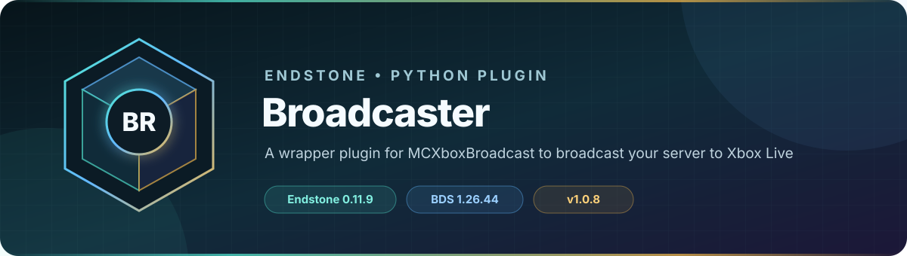

<!-- endstone-professional-header:start -->
<p align="center">
  
</p>

<p align="center">
  <a href="https://github.com/TheNINJALLO/endstone-broadcaster/actions/workflows/wheel-release.yml"></a>
  <a href="https://github.com/TheNINJALLO/endstone-broadcaster/releases/latest"></a>
</p>

<p align="center">
  
  
  
  =3.11" src="https://img.shields.io/badge/Python-%3E=3.11-3776AB?style=flat-square&amp;logo=python&amp;logoColor=white">
</p>

<p align="center">
  <strong>A wrapper plugin for MCXboxBroadcast to broadcast your server to Xbox Live.</strong>
</p>

<p align="center">
  <a href="#overview">Overview</a> &bull;
  <a href="#compatibility">Compatibility</a> &bull;
  <a href="#install">Install</a> &bull;
  <a href="https://github.com/TheNINJALLO/endstone-broadcaster/releases">Releases</a>
</p>

## Overview

A wrapper plugin for MCXboxBroadcast to broadcast your server to Xbox Live. This release is aligned with Endstone 0.11.8 and Minecraft Bedrock Dedicated Server 1.26.40, and is distributed as a Python wheel for direct installation in an Endstone server.

## Capabilities

-

## Compatibility

| Component | Supported version |
|---|---|
| Endstone | `0.11.8` |
| Endstone API | `0.11` |
| Bedrock Dedicated Server | `1.26.40` |
| Python | `>=3.11` |
| Plugin release | `v1.0.8` |

## Install

Download the wheel from the matching GitHub release:

```bash
gh release download v1.0.8 --repo TheNINJALLO/endstone-broadcaster --pattern "*.whl"
```

Copy the downloaded wheel into the server's `plugins/` directory, remove any older wheel for the same plugin, and restart Endstone.

> [!IMPORTANT]
> Use Endstone `0.11.8` with BDS `1.26.40`. Back up worlds and plugin data before upgrading a production server.

## Configuration and secrets

Runtime databases, logs, local `.env` files, server directories, and root `config.toml` files are excluded from source releases. When an example configuration is provided, copy it locally and keep live tokens, passwords, webhook URLs, and server identifiers out of Git.

## Release automation

Every `v*` tag runs [the wheel release workflow](.github/workflows/wheel-release.yml), builds the package in a clean GitHub runner, stores the wheel as a workflow artifact, and attaches it to the matching GitHub release.
<!-- endstone-professional-header:end -->

---

## Project guide

A Python wrapper plugin for Endstone that bridges your Bedrock server to Xbox Live using the `MCXboxBroadcast` standalone application. This plugin completely automates the installation, configuration, and lifecycle of the Broadcaster jar, making it totally seamless to deploy on both local Windows machines and Linux Pterodactyl panels.

## Features

- **Universal JRE Provisioning**: Automatically detects if your system (Windows/Linux/macOS, x64/ARM) lacks a Java installation (common in Pterodactyl Docker containers) and downloads a portable OpenJDK 17 Eclipse Temurin JRE just for the plugin to use!
- **Zero-Touch Configuration**: Automatically rips your `server-name`, `level-name`, and `server-port` right out of your root `server.properties` file.
- **Dynamic IP Resolution**: Auto-detects your server's public IPv4 address via `api.ipify.org` so Xbox players connect to the right IP.
- **Console Passthrough**: Securely intercepts the Java output and pipes it directly into your beautiful Endstone server console. It neatly boxes the Microsoft Device Auth URLs so you never miss a login prompt.

## Setup Instructions

1. **Download the Plugin**:
   Head to the [Releases](https://github.com/TheN1NJ4LL0/endstone-broadcaster/releases) page and download the latest `.whl` file.

2. **Install to Endstone**:
   Upload the `.whl` to your server and run:
   ```bash
   pip install endstone_broadcaster-1.0.3-py3-none-any.whl
   ```

3. **Authentication**:
   Start your server. Keep an eye on your console. The plugin will print a Microsoft authentication link and a device code:
   
   ```text
   [23:35:12 WARNING]: [Broadcaster] --- XBOX AUTH REQUIRED ---
   [23:35:12 WARNING]: [Broadcaster] To sign in, use a web browser to open the page https://microsoft.com/link and enter the code AB12CD34 to authenticate.
   ```

   - Go to the provided URL on any device.
   - Enter the code shown in the console.
   - Login with the Microsoft/Xbox account you want to use as the "bot" account.
   
   Once authenticated, the console will output a stylized success banner:
   
   ```text
   [23:35:39 INFO]: [Broadcaster] =======================================================
   [23:35:39 INFO]: [Broadcaster] Broadcaster Logged In: spareAccountName (0123456789876543) with 1/2000 friends
   [23:35:39 INFO]: [Broadcaster] =======================================================
   ```

4. **Add the Bot as a Friend**:
   On your actual Xbox account, send a friend request to the bot account. The bot will automatically accept it. 
   When the server is online, the bot will show up on your Xbox friends list playing "Minecraft". Join their session to instantly connect to your server!

## Configuration

If you want to manually modify the Broadcaster config (e.g., adding Discord/Slack webhooks or tuning the friend-expiration rules), you can find the generated configuration at:
`plugins/broadcaster/config.yml`

*Note: The plugin will always force-sync your `host-name`, `world-name`, `ip`, and `port` to match your active Endstone server properties every time the server boots, ensuring your friends can always connect!*
